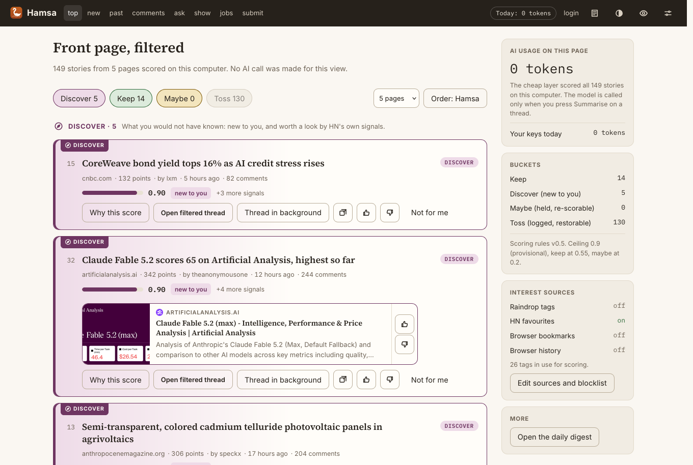
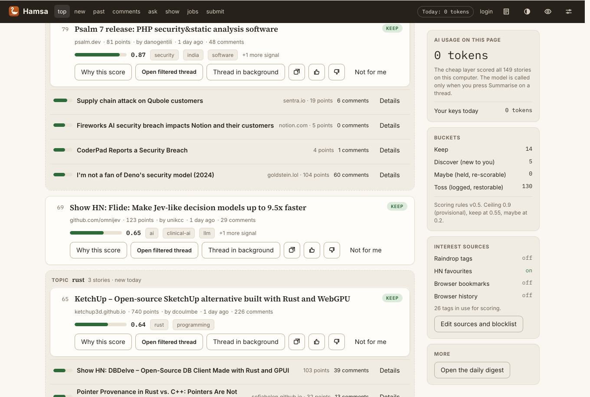
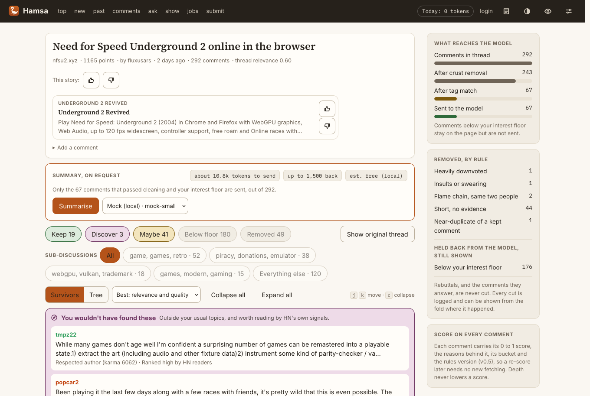
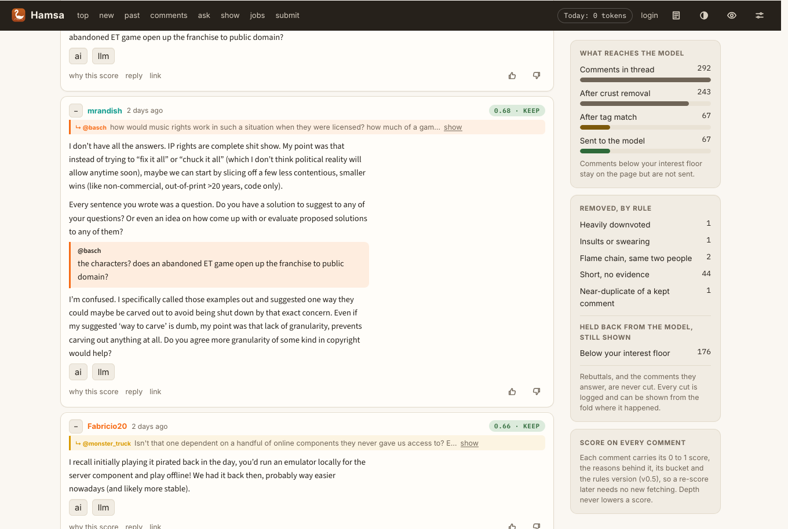
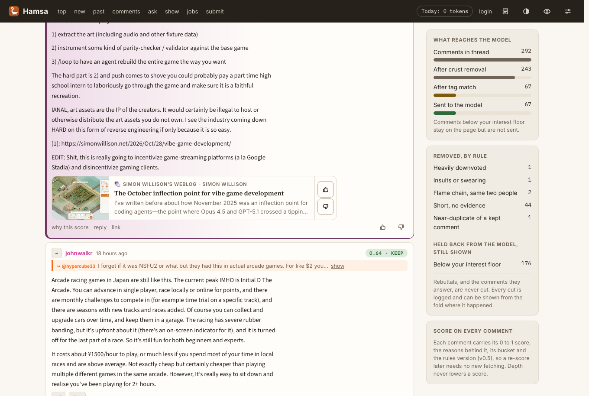
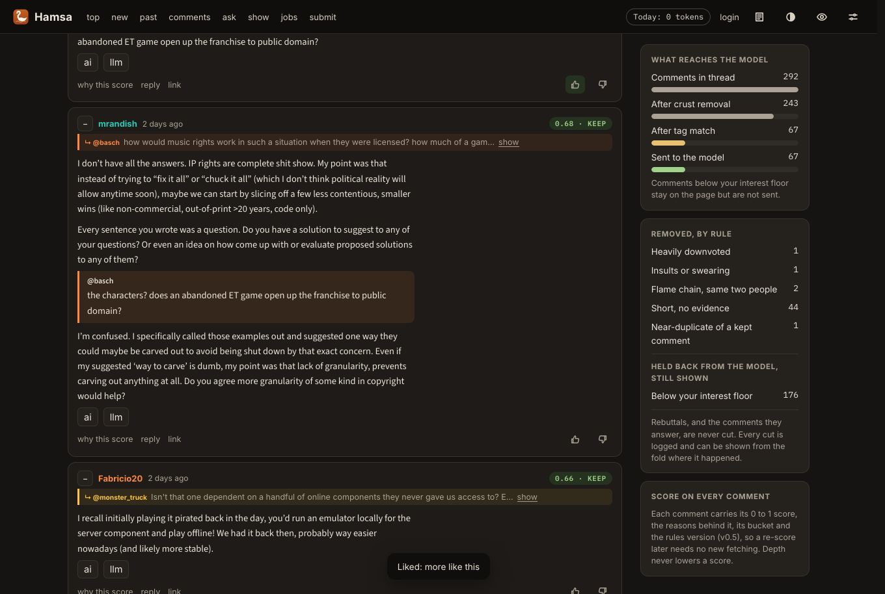
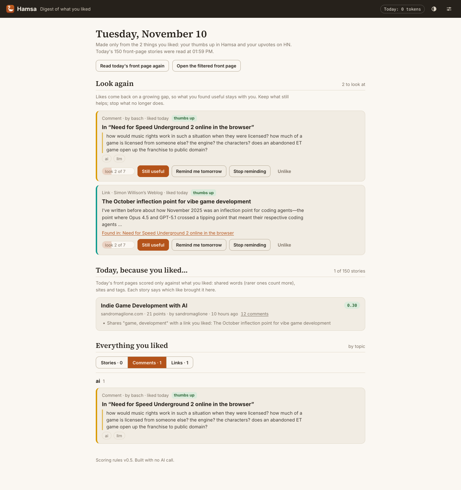

# Hamsa

Hamsa filters Hacker News before any model sees it. It is a Firefox add-on that redraws HN in place:

- **Front page**: pages 1 to 5 merged into one list, led by **Discover**: stories new to you that HN's own signals say are worth a look. Every story is scored from 0 to 1 against your own bookmarks and tags and sorted into discover, keep, maybe and toss, with the reasons one tap away. Tossed stories are hidden, never deleted.
- **Threads**: flame wars, insults, meta complaints, quote-only and empty replies are folded away with the rule that removed them. Rebuttals deep in a chain are protected. Comments are scored too, and the ones that match none of your interests stay on the page but are not sent to the model.
- **Summaries on request**: one call with your own key, on the comments that survived. The card shows the tokens sent and received and the cost, and the header keeps today's total.
- **Digest from your likes**: what you liked comes back on a spaced schedule (1, 3, 7, 16, 35, 90, 180 days), today's stories that resemble your likes, and every like by topic as stories, comments and links. No model.
- **Link previews**: a card with the title, picture and summary of each linked page, on threads and Discover stories, with a thumbs up that likes the link.
- **Threads that read like a conversation**: one bright colour per person, quotes as coloured blocks with the name of the person quoted, sub-discussions, and Discover comments highlighted in place.
- **Thresholds**: flame wars left out by default; minimum points and comments if you want them.
- **Blocklist**: a shareable JSON file of topic groups, written by hand, drafted by the model from your own words, or suggested from what you dismiss.
- **Reading**: a survivors-only scroll by default, with rebuttals under what they answer, smooth collapsing and j / k keys; or the full tree with tossed threads collapsed away. Duplicate submissions and near-duplicate comments are merged.
- **Ranking**: relevance first, then quality (HN's own vote-driven order, author karma, replies); ties on the front page broken by HN's gravity formula.
- **Learning from what you open**: sites, titles and tags you click become signals, and the reading log exports as JSONL for tuning a local model. Links can open in background tabs.
- **Taste**: thumbs up and down on stories and comments, and your HN votes, kept in the browser and used straight away.
- **Backup and sync**: one open JSON format (`hamsa.backup/1`) as a file, through Firefox Sync, or in a private GitHub gist.
- **Look**: Auto, Light and Dark as in Parshva, with warm, neutral or black dark styles; seven bundled fonts with pairings; text size, width, justified text and density; the plain HN pages themed to match.

## Install

Hamsa is not on the Mozilla add-ons site yet. Each release is signed by Mozilla (unlisted), so it installs on ordinary Firefox 140 or later:

1. Download the newest `hamsa-x.y.z.xpi` from [Releases](https://github.com/agravaaniresearch/hamsa/releases/latest) (or from the [`releases`](releases) folder).
2. In Firefox, open `about:addons`, click the gear icon and choose **Install Add-on From File…**, then pick the file.
3. Open Hamsa's settings, connect an interest source (Raindrop, browser bookmarks or your HN favourites) and press **Sync all sources**. Visit Hacker News.

Unlisted builds do not update themselves; install the next release the same way. An AI key is optional and only used for thread summaries you ask for.

## Screenshots

**Front page**: Discover leads, highlighted, with link previews.

**Topics**: stories on one subject grouped, scored as one, marked new or returning.

**Thread**: what reaches the model, sub-discussions, and comments you would not have found.

**Quotes in the colour of the person quoted**, and one colour per person.

**Link previews** inside comments, with a thumbs up that likes the link.

**Dark mode.**

**The digest**, made only from what you liked, with spaced review.

See [CHANGELOG.md](CHANGELOG.md) for what changed in each version.

See [DESIGN.md](DESIGN.md) for the reasoning and [SCHEMA.md](SCHEMA.md) for every rule, weight and file format.

## Interest sources

Raindrop (token), browser bookmarks (folders become tags), HN favourites and upvoted stories, browser history (sites only, opt-in), and any exported bookmarks file. Open settings, switch on what you want and press **Sync all sources**.

## Providers

OpenAI-compatible (OpenAI, DeepSeek, xAI, Qwen, Mistral, Groq, Together, Fireworks, OpenRouter, Ollama, LM Studio, custom URL), Anthropic native and Gemini native. Keys stay in `storage.local`.

## Layout

- `extension/lib`: `front` (listing pages), `parse`, `prune`, `render`, `thread` (comments), `score` (the 0 to 1 score), `graph` (tag relevance), `profile` (sites, favourites, history), `blocklist`, `cluster`, `subtopics` (sub-discussions), `preview` (link previews), `prefs` (likes and reviews), `backup` (backup and sync), `summarise`, `providers`, `pricing`, `raindrop`, `store`
- `extension/background.js`: all network calls, scoring and state changes
- `extension/content`: the in-page layer (`boot`, `common`, `front`, `thread`, `hamsa.css`, `skin.css`)
- `extension/digest`, `extension/options`, `extension/shared`, `extension/fonts` (bundled, SIL OFL)
- `test`: `npm test`

## Build and release

`npm ci && npm test && npm run lint`. Pushing to `main` runs `.github/workflows/release.yml`, which signs an unlisted XPI with Mozilla and publishes it as a release when the repository secrets `AMO_JWT_ISSUER` and `AMO_JWT_SECRET` are set; without them it builds an unsigned package only.
