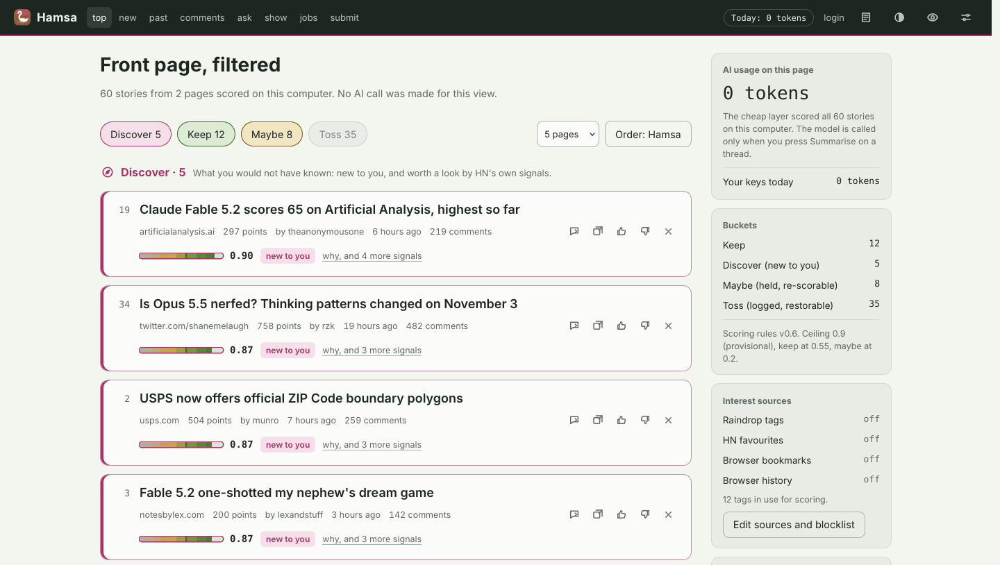
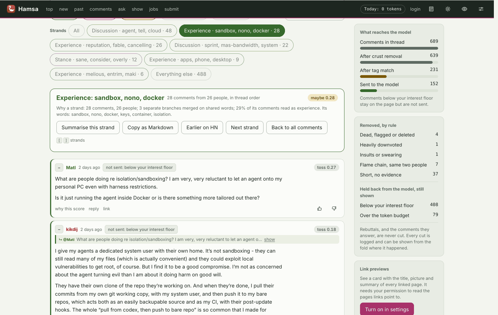
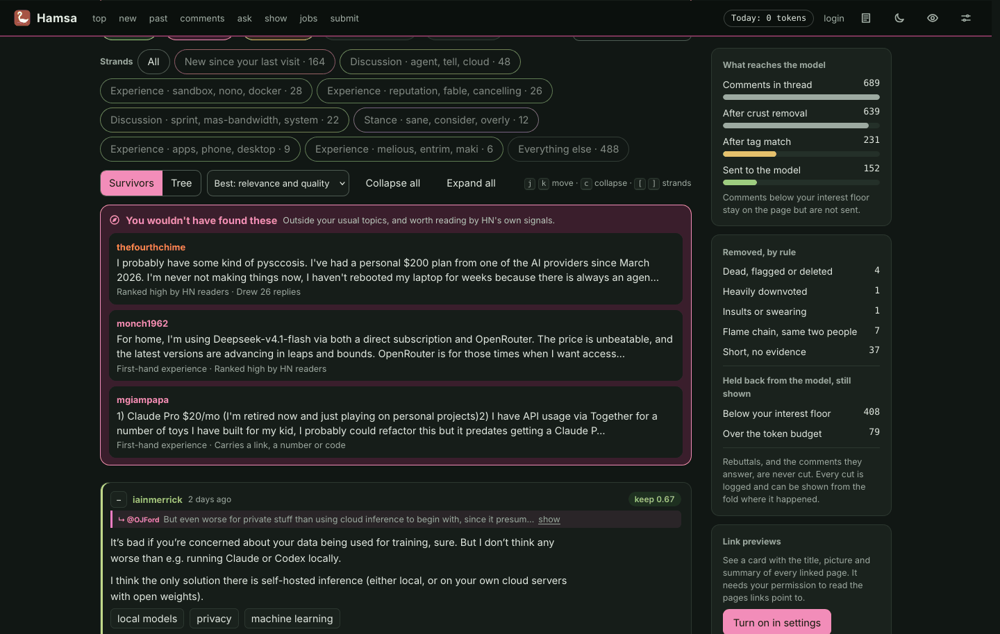
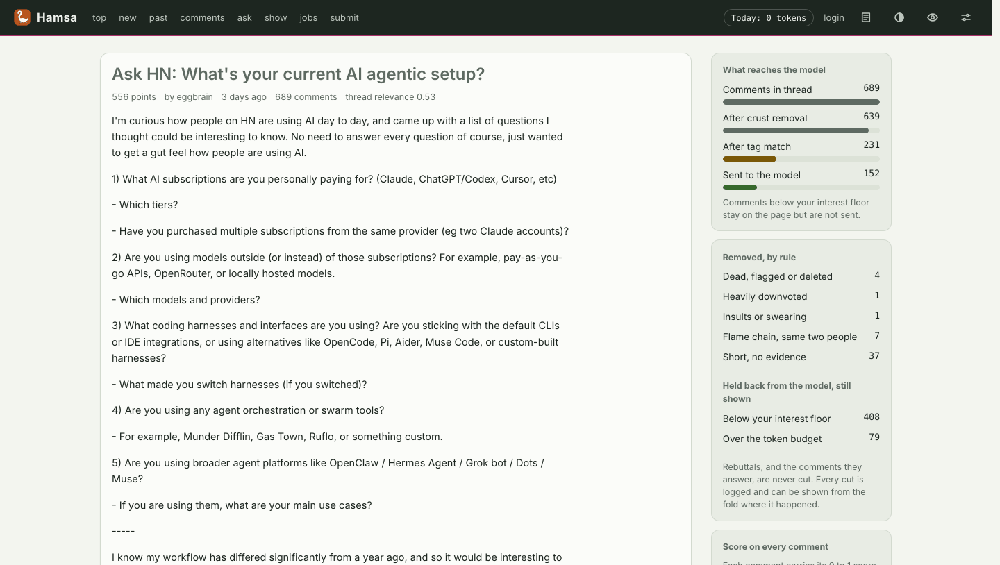
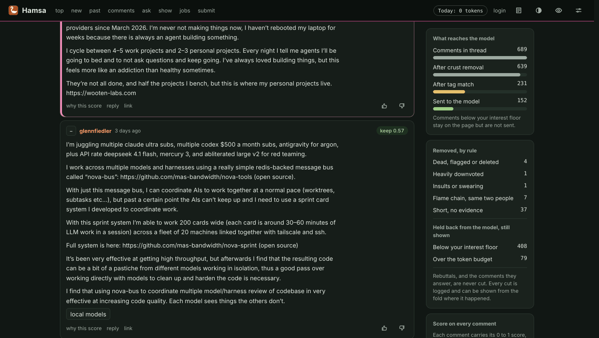
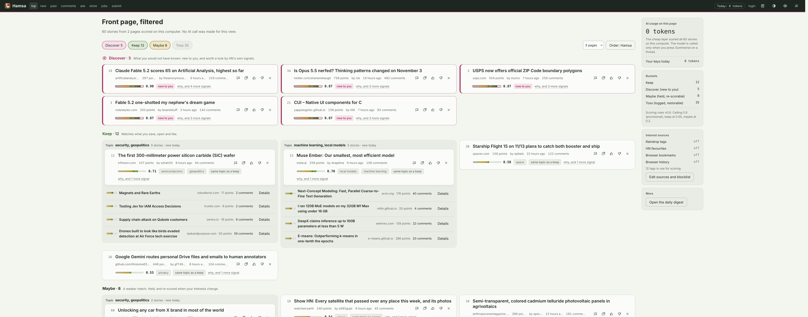
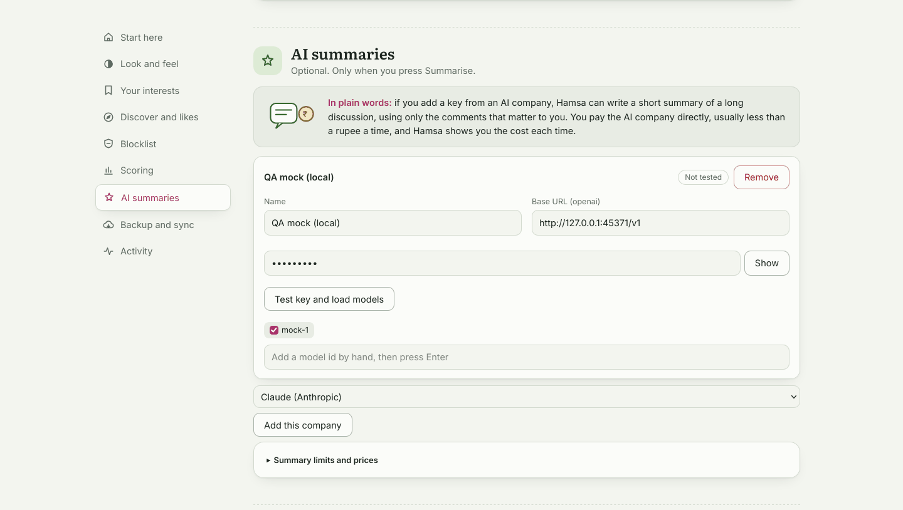

# Hamsa

Hamsa filters Hacker News before any model sees it. It is a Firefox add-on that redraws HN in place, scores every story and comment from 0 to 1 against your own bookmarks and tags, folds away flame wars and fluff, and says why each item survived. A model is called only when you ask for a summary, with your own key, on what is left.



A 32-second walkthrough of 0.7: [docs/hamsa-0.7.mp4](docs/hamsa-0.7.mp4); of 0.6: [docs/hamsa-0.6.mp4](docs/hamsa-0.6.mp4) (made with Remotion; screens use synthetic interests and saved HN pages).

## The idea

The hamsa, the swan of Indian tradition, is said to separate milk from water (*nira-kshira-viveka*). Hacker News is mostly water for any one reader: a few threads matter, and inside them a few comments carry the substance, often the rebuttal five replies deep. Hamsa does the separating with rules you can read, not with a model you have to trust.

1. **Rules first, model last.** Cleaning, relevance and ranking are deterministic, local and free. The model sees only what survived, and only when you press Summarise.
2. **Nothing is deleted.** Every story and comment lands in a bucket (Discover, Keep, Maybe, Toss) with the reason it landed there, and can be shown again.
3. **A score never travels without its reasons.** Tap any score to see each signal and its points.
4. **What you would not have found yourself comes first.** Discover is reserved for stories outside your tags that HN's own signals say are worth a look.
5. **Your sources, your keys, your browser.** Interests come from your Raindrop tags, browser bookmarks and HN favourites. Nothing leaves the browser except the calls you make.
6. **Light enough to forget.** No server, no account, no telemetry, no work at browser start.

Hacker News is the test bed. The same engine is meant to run over journal feeds and PubMed next (see [ROADMAP.md](ROADMAP.md)).

## What it does

- **Front page**: pages 1 to 5 merged into one list, Discover first, then Keep and Maybe; Toss hidden behind a chip. Stories on one subject grouped as topics, marked new today or returning. Duplicate submissions merged. Flame wars (many comments on few points) left out.
- **Threads**: crust removed by named rules (dead, heavily downvoted, insults, flame chains between two people, meta, quote-only, short), rebuttals protected, near-duplicate comments folded. Comments scored against your tags; off-topic ones stay on the page but are not sent to a model. A survivors-only scroll with rebuttals under what they answer, or the full tree; j and k move, c collapses.
- **Strands**: the conversations inside a thread, found by HN's own reply structure and shared words, each with a kind and a colour (debate, experience, explainer, alternatives, stance, meta). Open one to read all of it in thread order, summarise just that strand, copy it as Markdown, or step through strands with `[` and `]`.
- **New since your last visit**: the comments that arrived since you last opened a thread, in one pill.
- **Before this thread** (optional): earlier HN threads on the same link or subject, and earlier comments on a strand, from the public Algolia HN search, re-scored against your tags.
- **Health**: how much work Hamsa does in your browser (work per page, writes, requests per site), with a one-click Lightest mode.
- **Conversation, readable**: one colour per person, quotes shown as blocks in the colour of the person quoted, link previews.
- **Summaries on request**, with any provider (OpenAI-compatible, Anthropic, Gemini, local Ollama or LM Studio); tokens sent and received and the cost on every card.
- **Digest from your likes**: spaced review of what you liked (1, 3, 7, 16, 35, 90, 180 days) and today's stories that resemble it. No model.
- **Learning**: thumbs, HN votes and what you open teach Hamsa, in this browser, straight away.
- **Blocklist**: an open, shareable JSON file of topic groups, written by hand, drafted by a model from your words, or suggested from what you dismiss.
- **Automatic HN login** (optional), **backup and sync** (file or Firefox Sync), **self-updating** signed builds.

## What is new in 0.7

Strands replace word-only sub-discussions: each conversation in a thread gets a kind and a colour and can be read, summarised or copied on its own. Comments new since your last visit get their own pill. HN history (off until you switch it on) shows what HN said before. A Health panel shows how much work Hamsa does in your browser, with a Lightest mode. To keep the attack surface small, the GitHub gist backup and the browser-history interest source are gone, and author karma is no longer fetched on the front page. Details in [CHANGELOG.md](CHANGELOG.md).





## Install

1. Download the newest `hamsa-x.y.z.xpi` from [Releases](https://github.com/agravaaniresearch/hamsa/releases/latest) (or the [`releases`](releases) folder).
2. In Firefox, open `about:addons`, click the gear icon, choose **Install Add-on From File…** and pick the file. Builds are signed by Mozilla (unlisted), so they install on ordinary Firefox 140 or later.
3. Open Hamsa's settings, connect an interest source and press **Sync all sources**. Visit Hacker News.

From 0.6 on, Firefox updates Hamsa by itself (about once a day, or at once from `about:addons` → gear → *Check for Updates*). Copies older than 0.6 need 0.6 installed by hand once.

## Screenshots

**Thread**: what reaches the model, by rule, with Discover comments.



**Pond**, the dark theme.



**Full width** on an ultrawide screen: the front page in columns, comments at a reading measure.



**Settings**: every section explained in plain words; automatic HN login sits under Sources.



## A worked example on synthetic data

`npm run example` runs the cheap layer end to end with no browser, network or model: it builds a tag graph from eleven synthetic bookmarks, scores two saved HN front pages, and cleans a saved 689-comment thread. Abridged output:

```
1. Interests: 11 synthetic bookmarks -> 10 tags that can score
2. Front page: 60 stories -> discover 5, keep 0, maybe 0, toss 55
   0.97  discover  Claude Fable 5.2 scores 65 on Artificial Analysis, highest so far
         +0.45  Unfamiliar to you: 100% of its words are in none of your tags, opens or likes
         +0.27  Worth a look on HN: 297 points, 219 comments, rising fast
3. Thread "Ask HN: What's your current AI agentic setup?"
   689 comments -> 639 after crust removal -> 205 on your topics -> 147 would be sent (29,980 tokens)
   removed by rule: downvoted 1, abusive 1, flame_chain 8, short 36, below_floor 434, budget 58
4. No model was called.
```

What runs and why: step 1 is `lib/graph.js` turning tags into weighted term lists (rare tags count more, recent bookmarks a little more); step 2 is `lib/score.js` adding up named signals per story and squashing the total to 0 to 1, with Discover chosen separately for novelty and HN's own signals; step 3 is `lib/prune.js` applying the crust rules in a fixed order, then the interest floor, then the token budget. Eleven bookmarks are far too few to keep anything, which is why every non-Discover story lands in Toss here; a real library of thousands of tagged bookmarks fills Keep.

*Code and runs are synthetic and for illustrative purposes only.*

## Documentation

- [DESIGN.md](DESIGN.md): the reasoning.
- [SCHEMA.md](SCHEMA.md): every rule, weight, formula and file format.
- [ROADMAP.md](ROADMAP.md): what comes next, and what is deliberately left out.
- [DEPLOY.md](DEPLOY.md): testing, signing, releasing, where data lives and how things fail.
- [CHANGELOG.md](CHANGELOG.md): what changed in each version.

## Layout

- `extension/lib`: the engine and helpers: `graph` (tag relevance), `score` (the 0 to 1 score), `prune`, `parse`, `thread`, `front`, `cluster`, `strands`, `history` (Algolia), `health`, `blocklist`, `profile`, `prefs`, `preview`, `backup`, `summarise`, `providers`, `pricing`, `raindrop`, `store`, `idb` (IndexedDB for large data)
- `extension/background.js`: all network calls, scoring and state changes
- `extension/content`: the in-page layer (`boot`, `common`, `front`, `thread`, `hamsa.css`, `skin.css`)
- `extension/digest`, `extension/options`, `extension/shared`, `extension/fonts` (bundled, SIL OFL)
- `test`: `npm test` (unit tests, the 0.5 engine as a frozen reference, and the background page end to end)
- `scripts`: `example.mjs` (the worked example), `release.mjs` (sign and stage a release), `perf.mjs`

## Privacy

Hamsa runs only on news.ycombinator.com and talks only to HN, its public API (author karma, on threads), Raindrop (if you connect it), the AI provider you choose (only when you ask), the Algolia HN search (only if you switch on HN history) and, if you allow previews, the pages that links point to. It keeps everything in this browser. The HN password for automatic login, if you give one, is never synced, exported or sent anywhere but HN.

## Licence

Apache 2.0. Fonts: SIL Open Font License (see `extension/fonts/LICENSE.md`).
